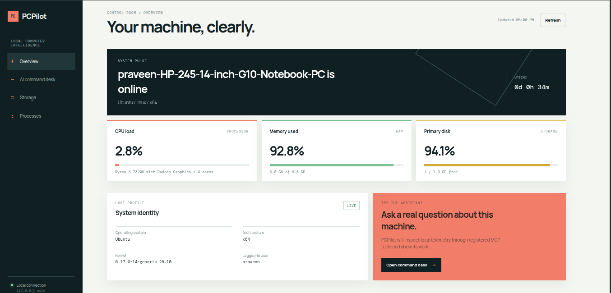
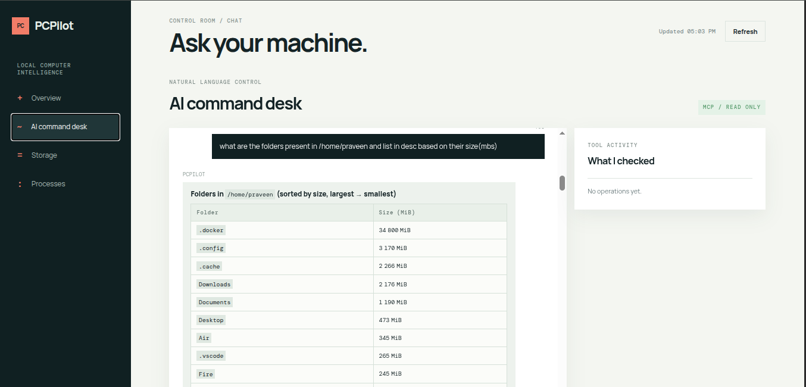

# PCPilot — Phases 1–6

PCPilot is a local-first Linux computer management assistant. Phases 1–5 provide a local MCP stdio server, MCP client, Groq orchestration, secure read-only filesystem tools, process monitoring, and a plain HTML/CSS/JavaScript dashboard.

The frontend will use normal HTML, CSS, and JavaScript served by Express. React and Vite are not used.

## Screenshots

### Overview dashboard



### AI command desk



## Implemented tools

- `get_system_info` — operating system, platform, architecture, hostname, kernel, and uptime
- `get_cpu_usage` — CPU usage, cores, model, and speed
- `get_ram_usage` — RAM totals, usage, free memory, and availability
- `get_disk_usage` — mounted partition capacities and usage

## Requirements

- Linux
- Node.js 22
- npm

## Install Node.js 22

Using nvm:

```bash
curl -o- https://raw.githubusercontent.com/nvm-sh/nvm/v0.40.3/install.sh | bash
source ~/.bashrc
nvm install 22
nvm use 22
node --version
```

## Install and test

```bash
cd /home/praveen/Air/PCPilot
npm install
npm test
npm run mcp
```

`npm run mcp` starts the server over stdio. It waits for an MCP client and normally has no visible terminal output. Stop it with Ctrl+C.

## MCP Inspector

To inspect and call the four tools interactively:

```bash
npx @modelcontextprotocol/inspector node backend/mcp/server.js
```

Open the URL printed by the Inspector. The actual system values come from `systeminformation`; no values are mocked.

## Project files

- `backend/services/systemService.js` — shared real-system data functions
- `backend/mcp/server.js` — MCP stdio server and tool registrations
- `backend/mcp/client.js` — MCP stdio client, tool discovery, and tool calls
- `backend/ai/agent.js` — Groq conversation and tool-call loop
- `backend/ai/toolExecutor.js` — allowlisted MCP tool execution
- `backend/services/groqService.js` — Groq SDK integration
- `backend/routes/chatRoutes.js` — Express chat endpoint
- `backend/server.js` — local Express backend entry point
- `test/systemService.test.js` — independent service tests
- `test/mcpClient.test.js` — MCP tool discovery and communication tests
- `test/agent.test.js` — multiple tool-call orchestration tests
- `package.json` — CommonJS configuration and scripts

## Phase 3: Groq chat

Copy `.env.example` to `.env` and set `GROQ_API_KEY`:

```bash
cp .env.example .env
npm start
```

Send a chat request:

```bash
curl -X POST http://127.0.0.1:3000/api/chat \
  -H 'Content-Type: application/json' \
  -d '{"message":"Show my CPU and RAM usage","history":[]}'
```

The agent discovers tools through MCP, sends discovered tool definitions to Groq, executes each Groq tool call through the MCP client, and supplies tool results in the follow-up request.

## Phase 4: filesystem and process tools

Phase 4 adds read-only tools for folder sizes, largest files, filename search, metadata, old files, duplicate files, directory trees, running processes, process details, and top CPU or memory processes.

Filesystem access is restricted to `PCPILOT_ALLOWED_DIRS`. When it is empty, the default is the current user's home directory. Paths are resolved with `realpath`; traversal outside an allowed root and symlink escapes are rejected or skipped. No shell commands are executed.

Destructive operations such as deleting files or terminating processes are not registered yet. They will be added only with explicit confirmation handling in the cleanup phase.

## Phase 5: local dashboard

The frontend is served directly by Express at `http://127.0.0.1:3000`. It uses no React, Vite, or frontend build step.

```bash
npm start
```

The dashboard includes:

- Live CPU, RAM, disk, uptime, and host identity cards
- AI command desk with conversation history and MCP tool activity
- Largest-file and duplicate-file storage scans
- Top-memory and top-CPU process tables

The dashboard polls system metrics every 2 seconds. Storage and process requests remain local and use the same service functions as the MCP tools.

## Phase 6: confirmed cleanup

Phase 6 adds cleanup scans and explicit deletion confirmation:

- `POST /api/files/cleanup/scan` reports temporary candidates without deleting anything.
- `POST /api/actions/confirm` creates a short-lived, one-use confirmation token for selected paths.
- `POST /api/files/cleanup/execute` deletes only the paths represented by that token.
- MCP exposes `scan_temporary_files`, `scan_cleanup_candidates`, and token-protected `delete_selected_files`.

Every deletion path is resolved and validated again at execution time. Paths outside `PCPILOT_ALLOWED_DIRS`, symlink escapes, directories, expired tokens, and reused tokens are rejected. Set `PCPILOT_CLEANUP_DIRS` to configure directories scanned by `scan_cleanup_candidates`.

## Ubuntu desktop application

PCPilot also runs as a native Electron desktop window. The Electron main process starts the existing Express backend on an OS-assigned loopback port, waits for its health endpoint, then loads the existing frontend from that backend. Closing the desktop app closes its HTTP server and MCP stdio connection. The app does not search for or terminate another process on a fixed port.

### Development

Use Node.js 22, install dependencies, and run Electron with the existing backend and frontend:

```bash
npm install
npm run dev
```

The original backend-only workflow remains available with `npm start`; the MCP stdio server can still be started with `npm run mcp`. Run `npm test` for the project tests.

### Groq configuration

Development continues to use the project-root `.env` file. In an installed build, PCPilot reads configuration from the current user's Electron configuration directory, normally `~/.config/PCPilot/.env`. Create that file yourself and set `GROQ_API_KEY` there; do not put credentials in the frontend or package. For example, create the directory with owner-only permissions, edit the `.env` file, then set the file permissions to `600`. The `.env` file is excluded from the Debian package. If no key is configured, local system and file features remain available and chat reports its existing configuration error.

### Build and install the Debian package

Build on Ubuntu or another compatible Linux system:

```bash
npm run build:linux
```

The current package is written to `release/PCPilot-0.3.0.deb`. Install it with:

```bash
sudo apt install ./release/PCPilot-0.3.0.deb
```

After installation, launch **PCPilot** from the Ubuntu Applications menu.

To use the AI command desk, Configure Groq for an installed build by creating ~/.config/PCPilot/.env with GROQ_API_KEY, then restrict access to the config directory/file.

To uninstall it through apt:

```bash
sudo apt remove pcpilot
```

The Debian package includes the Electron runtime and production dependencies, but excludes `.env` files, tests, Git metadata, and development-only files. Its app directory is intentionally unpacked so the existing MCP stdio server can be launched as an application-owned child without changing its architecture.

